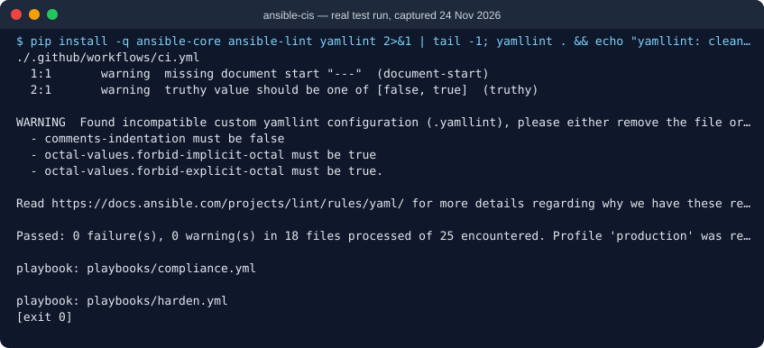

# ansible-cis — CIS Level 1 hardening role — manual

*One page, eight blocks. Every figure here comes from this repository's own tests and README.*

## 1. Claim
The role hardens a Debian/Ubuntu host to a CIS Level 1 profile, and a second run reports changed=0.

## 2. What it is
An Ansible role that applies the same security hardening to one server or ten thousand. Because it is idempotent, it can run on a schedule to correct drift. It also produces a before-and-after compliance report.

## 3. Demo
Capture to record: two consecutive runs (the second showing changed=0) and the generated `/tmp/cis-compliance-report.md`.


*Real output from this repository's own lint and syntax checks, captured 24 Nov 2026. The idempotence run needs a test host and is not shown.*

## 4. Run it yourself
**Prerequisites:** Ansible, plus a disposable Debian/Ubuntu host or VM.

```bash
ansible-galaxy collection install -r requirements.yml
ansible-lint
ansible-playbook playbooks/harden.yml
ansible-playbook playbooks/harden.yml
ansible-playbook playbooks/compliance.yml
```

## 5. What you will see
ansible-lint is clean at the production profile. The second harden run reports zero changes. The compliance playbook writes a pass/fail report.

## 6. 30-second talking point
> Compliance that drifts is not compliance. This role applies CIS Level 1 the same way every time, and proves it: a second run changes nothing, and the run produces its own audit report.

## 7. Scope and limits
- CIS Level 1 only. Level 2 and host-specific exceptions are deployment choices.
- Hardening can break bespoke applications. Test against your workload before enforcing.

## 8. Links
[Repository](https://github.com/fhionnghaile/ansible-cis) · [Write-up](https://padraigfhionnghaile.com/work/ansible-cis/) · [README](README.md)
